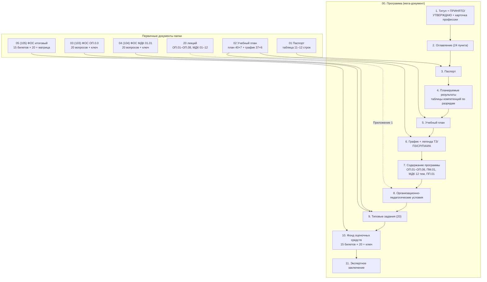

# Устройство программы `00` и принцип её формирования

Документ описывает, из чего состоит мега-документ `00.Программа_ПО_*.docx` в каждой учебной папке репозитория, как он соотносится с отдельными файлами `01`–`05` и лекциями, и по какому принципу его нужно собирать.

Числа в разделе 5 получены автоматической сверкой всех девяти папок (3 профессии × 3 вида обучения) по тексту `.docx`.

---

## 1. Схема документа

---

## 2. Состав `00` по разделам

| № | Раздел | Что внутри | Источник |
|---|---|---|---|
| 1 | Титул | ООО УЦ «ПрофСтрой», таблица ПРИНЯТО/УТВЕРЖДАЮ (директор Бастрюкова Г.А.), название программы, карточка «Профессия / Квалификация / Код ОКПДТР», г. Волгодонск, год | только в `00` |
| 2 | Оглавление | 24 пункта с номерами страниц | только в `00` |
| 3 | Паспорт | таблица 11–12 строк: нормативно-правовая основа, объём, срок, форма обучения, режим занятий, требования к образованию и опыту, периодичность (КПК), цели, формы контроля, итоговая аттестация | = `01` |
| 4 | Планируемые результаты | текст + «Таблица 1» + три таблицы 7×3 (умения / знания / уровень квалификации по разрядам) | только в `00` |
| 5 | Учебный план | таблица 40×7: №, наименование разделов, всего часов, теор./практ., форма контроля | = `02` |
| 6 | Календарный учебный график | таблица 37×6 (понедельное распределение) + легенда ТЗ, ПЗ, СР, ПА, ИА + расчёт недель | = `02` |
| 7 | Содержание программы | аннотации ОП.01–ОП.08 (1–3 абзаца), П.00, ПМ.01, МДК 01.01 с 12 темами, ПП.01 — перечень практических работ | аннотации только в `00`; темы = `02` |
| 8 | Организационно-педагогические условия | условия проведения занятий, требования к пед. кадрам (таблица), МТО (таблица оборудования 9×3), описание ЭОС, учебники, нормативные акты (таблица 31×2), ссылки (5×3), технологии обучения, отсылки к Приложениям 1–3 | только в `00`; Приложение 1 = лекции |
| 9 | Формы аттестации. Типовые задания | текущая / промежуточная / итоговая аттестация, шкала «отлично/хорошо/удовлетворительно», 20 типовых вопросов + таблица ключей 21×2 | ≈ `03` + `04` |
| 10 | Фонд оценочных средств | 15 билетов по 20 вопросов (300) + ключ ответов (таблица 17×21) | ≈ `05` |
| 11 | Экспертное заключение | 11 абзацев: соответствие 273-ФЗ, приказу № 534, профстандарту 275, ЕТКС; объём, сроки, кадры, МТБ, аттестация | только в `00` |

## 3. Что в `00` не входит

| Материал | Куда вынесен |
|---|---|
| 20 лекций (8 ОП + 12 МДК) | «Приложение 1», отдельные файлы `Лекции …docx` |
| Видео-лекции, презентации | «Приложение 2» (в репозитории отсутствует) |
| Таблицы, схемы, инструкции | «Приложение 3» (в репозитории отсутствует) |
| Тесты по разрядам (только КПК) | отдельная папка `Тест/` |

---

## 4. Принцип формирования

1. **Основа — паспорт и учебный план.** Из `01` берётся таблица паспорта целиком, из `02` — таблица учебного плана и таблица календарного графика вместе с легендой. Часы, разряды, код ОКПДТР, форма обучения должны совпадать с `02` до цифры.
2. **Содержание программы выводится из учебного плана.** Перечень дисциплин ОП.01–ОП.08 и 12 тем МДК 01.01 в разделе 7 повторяет строки плана; названия не переписываются вручную.
3. **Оценочные материалы — из ФОС.** Раздел 9 собирается из вопросов `03` и `04`, раздел 10 — из билетов `05`. Ключи переносятся вместе с вопросами.
4. **Лекции не входят в тело.** В разделе 8 ставится отсылка к Приложению 1; сами лекции лежат отдельными файлами и подчиняются учебному плану по часам.
5. **Экспертное заключение — итоговый контроль комплектности.** Оно ссылается на объём (288/144/72 ч), срок (8/4/2 недели), долю практики и профстандарт; эти цифры обязаны совпадать с паспортом и планом.

**Направление зависимости:** `01`, `02`, `03`/`04`/`05` → `00`. Мега-документ — производная, а не первоисточник. Обратный порядок (сначала `00`, потом выписки) допустим, только если `00` объявлен единственным источником истины, а `01`–`05` формируются из него автоматически.

---

## 5. Фактическое состояние (сверка 9 папок)

| Папка | Разделы 9–10 в `00` | Совпадение с `03` | Совпадение с `04` | Совпадение с `05` | Паспорт `01` → `00` | План `02` → `00` |
|---|---|---|---|---|---|---|
| Слесарь КПК | есть: 20 заданий + 300 вопросов, 15 билетов | 0 из 20 | 2 из 20 | 219 из 300 | 12 из 12 строк | 4 из 6 дисциплин |
| Слесарь ПП | есть: 300 вопросов, 15 билетов | 0 из 20 | 0 из 20 | 0 из 300 | 11 из 11 строк | 4 из 6 дисциплин |
| Слесарь П | только 20 типовых заданий, билетов нет | 0 из 20 | 0 из 20 | раздела нет | 11 из 11 строк | 4 из 6 дисциплин |
| Наладчик КПК | **разделов нет** | — | — | — | 12 из 12 строк | 1 из 6 дисциплин |
| Наладчик ПП | **разделов нет** | — | — | — | 11 из 11 строк | 2 из 6 дисциплин |
| Наладчик П | только заголовки «Типовые задания (Приложение)» и «ФОС (Приложение)», содержимое не вставлено | — | — | — | 0 из 11 строк | 2 из 6 дисциплин |
| Оператор КПК | 15 билетов есть, вопросы **без нумерации** — машинная сверка невозможна | — | — | — | файла `01` нет | файла `02` нет |
| Оператор ПП | то же | — | — | — | файла `01` нет | файла `02` нет |
| Оператор П | то же | — | — | — | файла `01` нет | файла `02` нет |

Выводы:

- **Единого источника нет.** Внутри `00` лежат собственные наборы вопросов, не совпадающие с `03`/`04`/`05`. Даже там, где разделы формально есть (Слесарь КПК), из 300 вопросов итогового ФОС совпадают 219, то есть 81 вопрос в `00` и `05` — разные.
- **Три разные реализации одного требования.** У Слесаря ФОС вставлен в тело; у Наладчика П есть только заголовки со ссылкой «(Приложение)», у Наладчика КПК и ПП разделов 9–10 нет вообще; у Оператора билеты вставлены, но вопросы не пронумерованы, из-за чего ни сверить, ни оценить их объём автоматически нельзя.
- **У Оператора нет отдельных `01` и `02`** — паспорт и учебный план существуют только в теле `00`, сверить их не с чем.
- **Паспорт воспроизводится точно** у Слесаря и Наладчика КПК/ПП (11–12 строк из 11–12), но у Наладчика П не совпадает ни одна строка.
- **Учебный план расходится везде**: в `00` находится от 1 до 4 названий дисциплин из 6, заявленных в `02`.

---

## 6. Правила, которые следуют из схемы

1. `00` не редактируется по частям: сначала правится первичный документ (`01`, `02`, `03`–`05`), затем раздел `00` пересобирается из него.
2. Любая правка часов, разрядов, кода ОКПДТР или названия профессии выполняется одновременно в `01`, `02` и `00` — иначе расхождение фиксируется сверкой (п. 5).
3. Набор вопросов в разделах 9–10 `00` должен быть подмножеством `03`/`04`/`05`; новые вопросы сначала появляются в ФОС.
4. Для Оператора, где `01` и `02` отсутствуют, их нужно выделить из `00` отдельными файлами — иначе паспорт и план невозможно проверить по чек-листу (разделы В и Г).
5. Лекции остаются вне `00`, но их часы обязаны совпадать со строками учебного плана (`Ж0.4`–`Ж0.6` чек-листа).

---

*Документ подготовлен по фактическому разбору файлов репозитория; числа раздела 5 воспроизводимы сверкой `.docx` по тексту разделов.*
